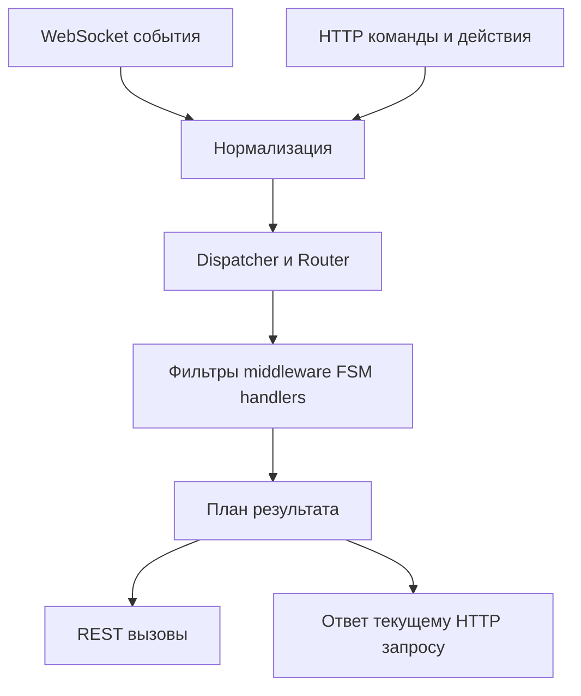

# Спецификация форка aiogram для Mattermost

**Версия документа:** 1.2  
**Дата:** 12 ноября 2026 года  
**Статус:** проект архитектуры и публичного контракта; реализация и фактическая совместимость ещё не подтверждены.  
**Рабочее имя основного пакета:** `mattergram`.  
**Рабочее имя расширения интерфейсов:** `mattergram_dialog`.

Названия пакетов условные. До публикации необходимо проверить их доступность и окончательно зафиксировать namespace.

## 1. Цель

Создать асинхронный Python-фреймворк для ботов Mattermost, API которого узнаваем для разработчика и нейросети, знакомых с aiogram 3.

Узнаваемость достигается сохранением модели разработки: `Bot`, `Dispatcher`, `Router`, декораторы обработчиков, `F`, фильтры, middleware, внедрение зависимостей, FSM, типизированные события и удобные методы ответа.

Функциональный состав определяется Mattermost. В библиотеку включаются документированные возможности Mattermost; отсутствующие Telegram-функции не переносятся. Сходство API не является обещанием запуска произвольного Telegram-бота после замены импорта.

Основной пользовательский сценарий: нейросеть получает эту спецификацию, документацию установленной версии и задачу на бота; создаёт корректный проект без угадывания импортов, протокольных полей и возможностей платформы.

## 2. Приоритеты и нормативные требования

В документе «должен» означает обязательное требование, «рекомендуется» — предпочтительный вариант, «может» — необязательное расширение.

При конфликте требований действует следующий порядок:

1. Реальные возможности и ограничения Mattermost.
2. Корректная семантика, права и протокол.
3. Узнаваемый синтаксис и организация aiogram.
4. Уменьшение объёма прикладного кода.
5. Совместимость со сторонними Telegram-библиотеками.

Обязательные правила:

- Знакомое имя сохраняется, когда операция имеет понятное соответствие в Mattermost.
- Отличающееся поведение документируется у самого метода и в таблице миграции.
- Не создаются фиктивные ID, сообщения, события или подтверждения доставки.
- Не поддерживаемая платформой операция не превращается в молчаливый no-op.
- Неизвестные аргументы публичных методов отклоняются.
- Один сценарий имеет один основной рекомендуемый способ реализации.
- Удобные aliases реализуются статически и перечисляются в документации.
- Нативный API остаётся доступен для возможностей вне high-level обёрток.
- Примеры содержат только API конкретной версии пакета.
- Skills создаются после стабилизации SDK и примеров.

## 3. Что означает семантическая близость к aiogram

| Область | Сохраняемый принцип | Адаптация |
| --- | --- | --- |
| Обработчики | Асинхронные функции и декораторы | События Mattermost |
| Router | Вложенные роутеры, фильтры, остановка обработки | Собственный набор observers |
| Фильтры | `F`, классы фильтров, передача найденных данных | Строковые ID и native payload |
| Middleware | Outer/inner порядок и контекст handler | Контекст HTTP, сервера и interaction |
| DI | Передача зависимостей через именованный контекст | Без неявных сетевых запросов |
| FSM | `State`, `StatesGroup`, `FSMContext` | Сервер, бот, канал, пользователь, тред |
| Ответы | `answer`, `reply`, `edit_text`, `delete` | Посты и треды Mattermost |
| CallbackData | Типизированные данные и фильтры | Context и допустимые action ID |
| Builders | Декларативное построение UI | Blocks, Actions и Forms |
| Запуск | Единый lifecycle | REST + WebSocket + HTTP callbacks |

Совместимость измеряется по конкретным контрактам и сценариям. Процент «совместимости с aiogram» без определённого набора тестов не публикуется.

## 4. Выбор основы форка

Рекомендуется выборочный форк ядра aiogram 3.

Переносить следует алгоритмы маршрутизации, цепочки фильтров и middleware, передачу handler data, FSM abstractions, lifecycle observers и переносимые утилиты. До переноса каждого модуля проверяются его импорты и зависимость от Telegram-моделей.

Перерабатываются:

- `Bot`, клиентская сессия, API methods и исключения.
- `Update` и все платформенные модели.
- Observers событий.
- User/context middleware.
- FSM keys и стратегии изоляции.
- Command parser для slash-запросов.
- HTTP request/response integration.
- Builders, serializer и проверка capabilities.
- Способы запуска и восстановления соединений.

Полный Telegram Bot API, его генератор типов и специфичные методы не включаются.

Не рекомендуется строить production-ядро на monkey patching установленного aiogram или подставлять собственные объекты вместо его Telegram-типов.

### 4.1. Upstream и лицензии

Перед началом реализации фиксируются tag и commit aiogram. Сохраняются исходные лицензии и уведомления в заимствованных файлах. Основной aiogram опубликован под MIT.

Для `mattergram_dialog` отдельно фиксируется commit `aiogram_dialog`; проект опубликован под Apache-2.0. Необходимо соблюдать требования его LICENSE, сохранять соответствующие уведомления и отмечать изменения.

Обновления upstream переносятся выборочно после тестов. Зависимость от плавающих веток `dev-3.x` или `develop` в релизе запрещена.

## 5. Базовый стек и существующие библиотеки

Рекомендуемый стек: Python 3.11+, `asyncio`, `aiohttp`, Pydantic 2, `magic-filter`. Redis предоставляется необязательной зависимостью.

| Проект | Роль при разработке |
| --- | --- |
| aiogram | Основная модель API и переносимое ядро |
| mattermostautodriver | Кандидат на закрытый low-level backend и пример генерации OpenAPI |
| MatterAio | Кандидат для сравнения async client и типизации |
| mmpy_bot | Пример Mattermost lifecycle, plugins и HTTP integration |
| python-mattermost-driver | Исторический reference; для новой основы не выбирать |
| aiogram_dialog | Выборочная основа отдельного пакета сложных UI |

Основная рекомендация — собственный минимальный `aiohttp` transport с чётким внутренним протоколом. В коротком прототипе его следует сравнить с адаптером `mattermostautodriver`.

Ни один сторонний driver не становится частью публичного API. Его исключения, модели и сигнатуры не должны проникать в handlers приложения.

В `mattermostautodriver` возможны несовместимые изменения при нумерации, следующей версии сервера. Например, версия 11.8.1 заменила старые Driver/AsyncDriver типизированными интерфейсами. Версия backend фиксируется и проверяется отдельно.

## 6. Архитектура



Слои:

| Слой | Ответственность |
| --- | --- |
| Transport | HTTP client/server, WebSocket, TLS, таймауты |
| Wire models | Структуры Mattermost без потери неизвестных полей |
| Normalizer | Преобразование wire payload в события SDK |
| Dispatcher | Lifecycle, routing и исполнение handlers |
| Context | Bot, server, user/channel, response и session |
| API facade | Узнаваемые методы бота |
| Native API | Явные endpoint wrappers и escape hatch |
| UI | Blocks, Actions, Form и сериализация |
| FSM | Состояния и блокировки разговоров |
| Dialog extension | Декларативные окна, формы, переходы |

Сетевой ввод, routing и бизнес-логика отделены. Нормализация не выполняет произвольные скрытые REST-запросы.

## 7. Идентификаторы, сущности и время

| Mattermost | Модель SDK | Требование |
| --- | --- | --- |
| Post | `Message` | Реальный post ID |
| Channel | `Channel` | Публичный/приватный/DM/group тип сохраняется |
| Team | `Team` | Отдельная сущность; не сводится к chat |
| User | `User` | Реальный user ID |
| root_id | `Message.root_id` | Корень треда |
| Unix milliseconds | Поле wire + доменное datetime | Единицы не смешиваются |

Все платформенные ID — строки. Нельзя преобразовывать их в int, хешировать для совместимости или генерировать замену отсутствующему ID.

В DM и group channels `team_id` может отсутствовать или быть пустым. Это не ошибка нормализации.

Доменное время сообщения — timezone-aware datetime; исходное значение wire сохраняется. Дата без времени остаётся `date`, а не искусственной полуночью UTC.

### 7.1. Узнаваемые aliases

Допускаются только точные aliases:

| Привычное поле | Нативное значение |
| --- | --- |
| `message.message_id` | `message.post_id` |
| `message.chat.id` | `message.channel_id` |
| `message.from_user.id` | ID автора |
| `message.text` | Текст post.message |
| `bot.send_message(chat_id=...)` | Пост в channel_id |

Это aliases одного значения, а не дублируемые изменяемые поля. В high-level API основной параметр отправки — `chat_id`, чтобы сохранить узнаваемость aiogram. В native API используются `channel_id` и `message`.

Нельзя одновременно принимать два конфликтующих имени одного аргумента. Методы native API не смешиваются с high-level сигнатурами.

Профили пользователя и канала могут быть частичными. `get_user()` и `get_channel()` выполняют явное получение данных. Доступ к свойству не запускает сеть.

## 8. Модели входящих событий

| Observer | Модель | Источник |
| --- | --- | --- |
| `router.message` | Message | WS posted |
| `router.edited_message` | MessageEdited | WS post_edited |
| `router.deleted_message` | MessageDeleted | WS post_deleted |
| `router.callback_query` | CallbackQuery | HTTP действия поста |
| `router.slash_command` | SlashCommand | HTTP команды |
| `router.dialog_submit` | DialogSubmission | HTTP отправка формы |
| `router.dialog_refresh` | DialogRefresh | HTTP обновление формы |
| `router.dialog_lookup` | DialogLookup | HTTP поиск вариантов |
| `router.dialog_cancel` | DialogCancelled | Уведомление отмены |
| `router.dialog_action` | DialogAction | Кнопка дочерней формы |
| `router.reaction_added` | ReactionAdded | WS |
| `router.reaction_removed` | ReactionRemoved | WS |
| `router.typing` | TypingEvent | WS |
| `router.raw_event` | RawEvent | Непокрытые typed события |

Остальные documented WS events получают типизированные observers по реестру: участники, команды, каналы, статусы, профили, треды и системные изменения.

`raw_event` — явный escape hatch. Он не должен автоматически повторно выполнять уже обработанный callback.

Общее event envelope содержит instance/bot identity, source, received_at, контекст канала/команды/пользователя, локальный correlation ID и исходный payload. Локальный ID не называется серверным update_id.

`SlashCommand` не является Message: у команды нет обязательного post_id. `DialogSubmission` также не маскируется под сообщение.

## 9. Контракт Router, фильтров, middleware и DI

Сохраняются следующие формы:

```python
router = Router(name="requests")

@router.message(F.text == "Привет")
async def hello(message: Message):
    await message.answer("Привет!")

@router.message(Command("help", prefix="!"))
async def help_message(message: Message):
    await message.answer("Создать заявку: /request")

@router.callback_query(F.data == "request:refresh")
async def refresh(query: CallbackQuery):
    ...

router.include_router(child_router)
dp.include_router(router)
```

Нормативная семантика:

- Сначала проверяются root filters текущего observer.
- Outer middleware оборачивают обработку до handler filters.
- Inner middleware выполняются для прошедшего фильтры handler.
- Фильтр возвращает bool либо словарь handler data.
- Успешный handler завершает поиск по принятому контракту.
- Продолжение поиска требует явного механизма вроде SkipHandler.
- UNHANDLED отличается от None, возвращённого успешно вызванным handler.
- Порядок регистрации и обхода дочерних роутеров детерминирован.
- Ошибки попадают в error observer с исходным контекстом.
- Startup/shutdown выполняются предсказуемо, включая частичный сбой запуска.

DI сохраняет именованный контекст aiogram: `bot`, `state`, `command`, `callback_data` и явно добавленные зависимости приложения. Type hints помогают проверке и документации; произвольная инъекция по одному типу без установленного правила не вводится.

Зарезервированные системные ключи нельзя молча перезаписать пользовательским результатом фильтра.

## 10. High-level Bot и удобные методы

Проект основного контракта:

```python
class Bot:
    def __init__(
        self, *, token: str, base_url: str,
        callback_base_url: str | None = None,
    ) -> None: ...

    async def get_me(self) -> User: ...
    async def send_message(
        self, chat_id: str, text: str, *,
        root_id: str | None = None,
        actions: Actions | None = None,
        blocks: list[Block] | None = None,
        priority: MessagePriority | None = None,
        silent: bool = False,
        file_ids: Sequence[str] | None = None,
    ) -> Message: ...
    async def edit_message_text(
        self, chat_id: str, message_id: str, text: str,
    ) -> Message: ...
    async def delete_message(self, chat_id: str, message_id: str) -> None: ...
    async def send_document(
        self, chat_id: str, document: InputFile, *,
        text: str | None = None, root_id: str | None = None,
    ) -> Message: ...
    async def send_documents(
        self, chat_id: str, documents: Sequence[InputFile], *,
        text: str | None = None, root_id: str | None = None,
        priority: MessagePriority | None = None, silent: bool = False,
    ) -> Message: ...
    async def get_user(self, user_id: str) -> User: ...
    async def get_channel(self, channel_id: str) -> Channel: ...
    async def create_direct_channel(self, user_id: str) -> Channel: ...
```

Это эскиз сигнатур. Перед реализацией он переносится в type stubs и контрактные тесты; наличие строки здесь не означает реализованный метод.

### 10.1. Message shortcuts

| Метод | Поведение |
| --- | --- |
| `message.answer(text)` | Новый пост в тот же канал, без автоматического root_id |
| `message.reply(text)` | Пост в тред: root_id исходного корня либо ID исходного поста |
| `message.edit_text(text)` | Изменение указанного поста с правами текущего бота |
| `message.delete()` | Удаление указанного поста с правами текущего бота |

Ответ в тред не является ссылкой на конкретную Telegram reply-сущность. Для reply на ответ используется исходный корень треда.

Полученное сообщение нельзя редактировать как своё только потому, что SDK предоставляет shortcut: серверные права сохраняются.

Операции редактирования должны предпочитать безопасный patch, когда он соответствует задаче; omitted props не должны непреднамеренно очищать attachments или actions.

Для редактирования UI различаются UNSET — оставить существующее значение, None — явно убрать соответствующий компонент и конкретное значение — заменить. Это отличие должно отражаться в signatures, stubs и примерах. При создании поста None означает отсутствие компонента. Параметры actions и blocks могут использоваться совместно только через единый compiler и согласованный registry; два независимых несогласованных описания actions не допускаются.

### 10.2. Native API

```python
await bot.api.posts.create(
    channel_id=channel_id,
    message="Сообщение",
    root_id=root_id,
)
```

Native layer использует терминологию и поля Mattermost. Его scope и coverage публикуются отдельно. Генерация из OpenAPI привязана к закреплённой версии схемы.

## 11. Настоящие slash-команды

Обычная текстовая команда `!help` приходит как сообщение. Зарегистрированная `/request` обрабатывается HTTP-интеграцией Mattermost.

```python
@router.slash_command(Command("request"))
async def request(command: SlashCommand):
    await command.answer("Заявка принята", ephemeral=True)
```

Обязательные свойства:

- Handler declaration и серверный объект команды — разные сущности; SDK синхронизирует их автоматически при включённом provisioning.
- Сами декораторы объявляют manifest. Bootstrap/Sync создаёт и обновляет серверные команды без ручной регистрации каждой команды.
- Команды учитывают область команды/team и собственный integration token.
- Аргументы читаются из slash payload без фиктивного Message.
- Поддерживаются autocomplete, hint и описание.
- Ответ может быть ephemeral либо in_channel; default документируется явно.
- response_url хранится как секрет с ограниченным сроком использования.
- command.open_dialog(form) использует trigger текущего действия.
- Встроенные команды Mattermost не переназначаются библиотекой.

По документации response_url позволяет пять дополнительных сообщений в течение 30 минут. Это отдельное ограничение, не срок действия trigger_id и не срок жизни bot token.

При завершении короткого handler без результата HTTP adapter может вернуть пустой допустимый ACK. Долгая работа требует явной стратегии deferred response или надёжной фоновой задачи.

### 11.1. Автоматическая регистрация и bootstrap

Серверная регистрация выполняется автоматически SDK при явно включённом provisioning. Пользователь не должен создавать каждую slash-команду в интерфейсе Mattermost.

Handler declaration и серверный объект остаются разными сущностями, но их синхронизация — задача фреймворка.

В Mattermost нет отдельного типа «root token» для SDK. Под setup token подразумевается действительный API token учётной записи с нужными правами. Это может быть Personal Access Token системного администратора либо более ограниченной provisioner-учётной записи. Права определяются аккаунтом и настройками сервера, не названием переменной.

Для одних команд достаточно manage_slash_commands в целевой team. Полное создание бота требует также разрешений на bot account, токен и членство. Нельзя требовать System Admin только ради декларации команды, если текущих прав достаточно.

### 11.2. Декларация команды

```python
@router.slash_command(
    Command("help"),
    description="Показать справку",
)
async def help_command(command: SlashCommand):
    await command.answer("Доступные команды: /help, /request")

@router.slash_command(
    Command("request"),
    description="Создать заявку",
    hint="[тема]",
)
async def request_command(command: SlashCommand):
    ...
```

Параметры description/hint — явные поддерживаемые metadata observer, а не произвольные kwargs. На их основе SDK строит autocomplete definition и server manifest.

Допустим только однозначно экспортируемый trigger. Regex, динамическое вычисление Command или зависимость маршрутизации от произвольного фильтра не угадываются: для них требуется явная регистрационная спецификация. Несколько literals экспортируются отдельно, если это подтверждено контрактом.

Наличие обработчика не регистрирует literal-команды обычных сообщений и не создаёт Telegram BotCommand. Native slash registration имеет team scope, URL, метод и собственный integration token.

### 11.3. Рекомендуемые режимы

| Режим | Работа |
| --- | --- |
| Runtime | Готовый bot token и сохранённые command/session secrets; без административных изменений |
| Bootstrap | Обеспечить объявленные bot/team/channel ресурсы, членство и команды; передать runtime готовый Bot |
| Sync | Сверить manifest с существующими управляемыми командами при деплое |
| Plan | Показать изменения без мутаций; необязателен для обычного автоматического запуска |

Главный сценарий — Bootstrap/Sync как init job или фаза запуска перед readiness. Разработчик явно включает этот режим один раз в конфигурации; отдельное ручное подтверждение каждой команды не требуется.

Реализованный интерфейс:

```python
import os
from pathlib import Path

from pydantic import SecretBytes

from mattergram.provisioning import (
    Bootstrap,
    BotSpec,
    FernetCodec,
    SQLiteProvisioningStore,
    TeamSpec,
)

# К этому моменту все Router подключены к dp.
store = SQLiteProvisioningStore(
    Path(os.environ["MM_STATE_DIR"]),
    codec=FernetCodec(SecretBytes(os.environ["MM_PROVISIONING_KEY"].encode("ascii"))),
)
bootstrap = Bootstrap(
    base_url=os.environ["MM_URL"],
    token=os.environ.get("MM_SETUP_TOKEN"),
    application="request-service",
    bot=BotSpec(username="request-bot", display_name="Request Bot"),
    store=store,
    callback_base_url=os.environ["MM_CALLBACK_URL"],
    team=TeamSpec(key="main", name="engineering", existing_policy="reuse"),
)
bot = (
    await bootstrap.prepare(dp)
    if os.environ.get("MM_SETUP_TOKEN") is not None
    else await bootstrap.load_runtime(dp)
)

await dp.start(bot, host="0.0.0.0", port=8080)
```

`MM_STATE_DIR` должен указывать на постоянное защищённое хранилище, а encryption key передаётся отдельно. `prepare()` собирает metadata обработчиков из переданного Dispatcher, поэтому команды не нужно дублировать отдельным списком. После успешного init job `load_runtime()` использует только сохранённые runtime/command credentials и не требует setup token. Эксплуатационные ограничения: [bootstrap.md](bootstrap.md).

Если бот уже существует, bootstrap использует подтверждённый bot_id и существующий доступный secret. Одного совпадения username недостаточно для автоматического присвоения чужого аккаунта.

### 11.4. Порядок provisioning

1. Проверить identity setup token, серверный профиль, необходимые права и доступные настройки.
2. Разрешить указанную team и каналы в реальные ID; создать отсутствующие только по явным TeamSpec/ChannelSpec, с порядком зависимостей из раздела 11.11.
3. Создать managed bot либо подключить явно определённый существующий.
4. Создать runtime access token при необходимости и сразу сохранить секрет.
5. Обеспечить членство в явно перечисленных team/channels.
6. Собрать command manifest подключённых роутеров.
7. Создать недостающие команды в каждой целевой team.
8. Обновить description, autocomplete, hint и callback URL только у управляемых команд.
9. Получить/сохранить command tokens из доступных ответов API и сформировать verifier map.
10. Передать runtime bot token, command bindings и secrets без setup credential.
11. Запустить/подключить HTTP, WS и проверки готовности в согласованном lifecycle.

Порядок открытия HTTP listener относительно регистрации определяется orchestrator. Pod не считается ready, пока команды указывают на обслуживаемый endpoint. Регистрация URL сама по себе не доказывает доступность callback из Mattermost.

### 11.5. Повторный деплой и хранение состояния

Provisioning должен быть идемпотентным:

- Один и тот же manifest не создаёт дубли команд и токенов.
- Ключ управляемой команды включает server, application identity, team и trigger; server command_id хранится отдельно.
- Существующая команда с таким trigger не присваивается приложению по одному имени.
- Изменяется только ресурс с доказанной принадлежностью.
- Чужая команда или встроенный trigger вызывают явный конфликт.
- Удаление команд из кода не удаляет серверные объекты по умолчанию; для этого предусмотрен отдельный prune policy только managed resources.
- Command tokens и bot tokens не ротируются при каждом рестарте.
- При потере секрета SDK не обещает восстановить его из GET; восстановление или ротация выполняются явной policy.
- Поддерживается блокировка или лидерство, чтобы несколько replicas не выполняли bootstrap параллельно.
- После частичного сбоя повторный запуск продолжает сверку, не откатывая чужие или общесерверные ресурсы.

Manifest, command IDs, ownership records и статус шагов хранятся постоянно. Secrets хранятся отдельно от диагностических отчётов. Потеря локального state не должна приводить к созданию нового bot token при каждом запуске.

Сгенерированный секрет сохраняется до перехода к следующей операции. Если сервер выполнил создание, а сохранить секрет не удалось, ошибка должна содержать ID ресурса без значения секрета и путь восстановления.

### 11.6. Права и серверные настройки

| Операция | Условие |
| --- | --- |
| Создать/получить/обновить команды | manage_slash_commands в соответствующей team |
| Создать bot account | create_bot и разрешённое создание ботов |
| Выпустить bot access token через user token API | create_user_access_token; для другого аккаунта также edit_other_users |
| Добавить в team/channel | Соответствующие membership permissions и политики |
| Изменить серверную конфигурацию | Доступ к config API, поддерживаемые изменяемые settings |

EnableCommands, EnableBotAccountCreation и разрешения токенов проверяются заранее. Администраторский токен не отменяет выключенный feature flag, environment override, Cloud policy или сетевые ограничения.

В полном self-hosted bootstrap допускается заранее объявленный allowlist изменений нужных settings, например EnableCommands и EnableBotAccountCreation. Изменения включаются явной настройкой change_server_settings и отражаются в отчёте. Прочие параметры сервера не переписываются.

Если PAT как механизм недоступен или исходный токен не принимается, нельзя этим же неработающим токеном включить собственную авторизацию: потребуется первоначальная настройка администратора или другой разрешённый способ доступа.

### 11.7. Setup credential и эксплуатация

Setup token используется отдельным административным клиентом. Runtime Bot не наследует административную сессию и выполняет обычные действия своим токеном.

Варианты деплоя:

- Init job получает setup token, синхронизирует ресурсы и записывает runtime secrets; основной контейнер не получает setup token.
- Один процесс выполняет setup phase при старте, затем запускает runtime client. Наличие секрета в environment этого процесса не выдаётся за его физическое удаление.
- Повторная синхронизация новых команд использует setup credential при следующем деплое либо отдельного provisioner с достаточными правами.

После удаления setup credential существующие команды продолжают работать при доступных runtime secrets. Создание новых и изменение серверных определений требует credentials с соответствующими правами. Это нельзя обещать от обычного bot token без проверки.

Настройка DNS, TLS, reverse proxy и открытие сетевого маршрута относятся к инфраструктуре деплоя. Mattermost API token сам по себе не разворачивает эти компоненты.

### 11.8. Приёмка автоматической настройки

- После первого деплоя доступны все объявленные slash-команды без ручного создания.
- Второй идентичный запуск не создаёт новых bot accounts, access tokens и команд.
- Изменённые description/hint/URL обновляются.
- Команды синхронизируются независимо по нескольким teams.
- Runtime проверяет правильный integration token для каждой пары team/command.
- Секрет одной команды не принимается как wildcard для всех остальных.
- Посторонний trigger не перезаписывается.
- Потеря state и частичный сбой имеют документированный recovery.
- Несколько replicas не дублируют provisioning.
- Без setup credential runtime продолжает обслуживать уже настроенные команды.
- Добавление новой команды без management credential даёт явную ошибку синхронизации.
- Настройка не выдаёт боту System Admin для обычной работы.

Источники: [Create command](https://docs.mattermost.com/api/reference/create-command), [Commands API](https://docs.mattermost.com/api/reference/commands), [Create bot](https://docs.mattermost.com/api/reference/create-bot), [Create access token](https://docs.mattermost.com/api/reference/create-user-access-token), [Personal access tokens](https://docs.mattermost.com/developers/integrate/reference/personal-access-token), [Integration settings](https://docs.mattermost.com/administration-guide/configure/integrations-configuration-settings), [Config patch](https://docs.mattermost.com/api/reference/patch-config).

### 11.9. Декларативное создание каналов и других ресурсов

Provisioning распространяется на каналы, team и явно заданные зависимости приложения. Разработчик описывает желаемое состояние; SDK выполняет доступные API-операции при деплое. Ручное создание канала, поиск ID, добавление бота и настройка отдельных slash-команд не должны быть обязательными действиями.

Все изменения выполняются в рамках явно заданного resource manifest и прав setup actor. Runtime сохраняет привычные Bot/Router/handler методы.

### 11.10. ChannelSpec и TeamSpec

Реализованная конфигурация:

```python
import os
from pathlib import Path

from pydantic import SecretBytes

from mattergram.provisioning import (
    Bootstrap,
    BotSpec,
    ChannelSpec,
    FernetCodec,
    SQLiteProvisioningStore,
    TeamSpec,
)

# Все router уже подключены к dp.
store = SQLiteProvisioningStore(
    Path(os.environ["MM_STATE_DIR"]),
    codec=FernetCodec(SecretBytes(os.environ["MM_PROVISIONING_KEY"].encode("ascii"))),
)
bootstrap = Bootstrap(
    base_url=os.environ["MM_URL"],
    token=os.environ["MM_SETUP_TOKEN"],
    application="notification-service",
    bot=BotSpec(username="notification-bot", display_name="Notification Bot"),
    store=store,
    callback_base_url=os.environ["MM_CALLBACK_URL"],
    team=TeamSpec(key="main", name="engineering", existing_policy="reuse"),
    channels=(
        ChannelSpec(
            key="alerts",
            team="main",
            name="service-alerts",
            display_name="Уведомления сервисов",
            visibility="private",
            create_if_missing=True,
            existing_policy="reuse",
            add_bot=True,
        ),
    ),
)
bot = await bootstrap.prepare(dp)

alerts = bot.resources.channels["alerts"]
await bot.send_message(chat_id=alerts.id, text="Сервис восстановлен")
await dp.start(bot, host="0.0.0.0", port=8080)
```

Показанная отправка — явное прикладное действие; bootstrap не рассылает стартовые сообщения при каждом рестарте. Для неё проверяется доступность канала runtime-токеном.

ChannelSpec:

| Параметр | Контракт |
| --- | --- |
| key | Стабильный ключ приложения; не зависит от server channel_id |
| name | URL-name канала внутри выбранной team |
| display_name | Отображаемое название при создании |
| visibility | Явно public или private; native O/P скрыты за сериализатором |
| create_if_missing | Разрешение создать отсутствующий ресурс |
| existing_policy | error либо reuse; не означает владение чужим ресурсом |
| add_bot | Обеспечить членство бота |
| members | Необязательный явный список существующих пользователей |
| purpose/header | Применимые свойства канала |
| channel_id | Альтернативная привязка к явно заданному существующему каналу |

Одновременные конфликтующие способы идентификации отклоняются. Короткая строка в channels остаётся ссылкой на существующий канал; создание отсутствующего явно выражается ChannelSpec.

channels необязателен и по умолчанию пуст. Бот может работать только с DM, командами или формами без отдельного общего канала. SDK не создаёт канал «на всякий случай».

По умолчанию team задаётся ссылкой на существующую team. Для создания отсутствующей используется TeamSpec с create_if_missing=True и явно заданными свойствами. Одна опечатка в имени ссылки не должна создавать новую team.

### 11.11. Алгоритм ensure channel

1. Разрешить team в ID; при явно разрешённом создании TeamSpec создать её и сохранить binding.
2. Проверить create/read/membership permissions setup actor для выбранного типа ресурса.
3. Найти канал по сохранённому ID, явному ID либо team + name.
4. Отделить доказанное отсутствие от недостатка доступа, скрытого private-ресурса и архивного состояния.
5. Создать канал, только если отсутствие подтверждено и create_if_missing=True.
6. При reuse существующего канала проверить team, тип, доступ и политику привязки.
7. Обеспечить сначала необходимое членство бота в team, затем в канале.
8. Сохранить соответствие resource key → server/team/channel ID.
9. Проверить доступ runtime-токеном; не заменять его административным при ошибке.
10. Вернуть bot.resources с типизированными доступными bindings.

POST /channels создаёт и публичные, и приватные каналы при разных разрешениях. Членство добавляется отдельной операцией API. Для создания team требуется отдельное create_team permission.

Роль создателя и его фактическое членство учитываются как результат Mattermost. Служебная provisioner-учётная запись не удаляется автоматически из созданного канала без отдельной policy.

Существующий канал с matching name можно использовать только при explicit reuse; такая привязка не даёт SDK право менять его название, privacy, purpose или состав пользователей. Созданные приложением ресурсы отмечаются как owned в provisioning store. Ownership и reuse — разные состояния.

### 11.12. Пользователи и уведомления

Основной сценарий пользователя:

1. Деплой описывает канал уведомлений.
2. SDK создаёт или подключает канал и добавляет бота.
3. Администратор добавляет нужных людей обычными средствами Mattermost.
4. Приложение отправляет сообщения по resource key без ручного поиска ID.

Ручное добавление людей сохраняется стандартным вариантом. Если members перечислены явно, SDK может обеспечить добавление существующих пользователей при достаточных правах. Участник канала должен соответствовать требованиям team и серверных политик.

Автоматический поиск пользователей не угадывает личность по display_name. Предпочтительны однозначные user_id или username. Создание новых аккаунтов и приглашение по email — отдельные явно объявленные действия, а не побочный эффект добавления members.

По умолчанию применяется add-only policy: добавить явно перечисленных участников, не удалять остальных. Ручные изменения состава сохраняются. Авторитетное полное управление membership включается отдельно; при обычном рестарте список людей не заменяется.

Сообщение в канале и push/email-уведомление каждому участнику — разные результаты. SDK не обещает принудительную доставку push независимо от mute, DND и личных настроек. @channel/@here и приоритет используются только как явная политика приложения, с сохранением ограничений сервера.

### 11.13. Другие сценарии и runtime provisioning

Тот же механизм может описывать несколько каналов: alerts, audit, control, отчёты или отдельные проекты. У каждого свой stable key, visibility и policy. Канал control не обязателен для существования бота.

Для обычного приложения достаточно startup provisioning. Если бизнес-сценарий требует динамически создавать канал после запуска, runtime должен иметь явный доступ к Provisioner с нужными credentials. Токен бота не получает несуществующие права автоматически. Admin fallback внутри обычного send_message запрещён.

Входящие webhooks, команды, членство и другие поддерживаемые ресурсы подключаются отдельными spec/adapters через общий planner/reconciler. Не объявленные ресурсы не создаются автоматически. Включение каждого adapter имеет проверяемый permission contract.

### 11.14. Идемпотентность, конфликты и критерии приёмки ресурсов

- Идентичный повторный деплой сохраняет channel_id и не создаёт дублей.
- Ключ канала учитывает instance, application, team и resource key.
- Каналы с одинаковым name в разных teams различаются.
- Ошибка 403 или скрытый private-канал не трактуются как разрешение создать замену.
- Race при одновременном создании приводит к повторной проверке binding, а не к ресурсу с произвольным новым именем.
- Public/private mismatch вызывает явную ошибку; автоматического изменения приватности нет.
- Архивный канал не восстанавливается и не заменяется новым без отдельной policy.
- Исчезновение ресурса из manifest не удаляет канал и его историю по умолчанию.
- Ручные участники не удаляются add-only синхронизацией.
- Недостаток runtime permissions выявляется до readiness без административной подмены.
- При частичном сбое последующий запуск восстанавливает managed bindings без дублей.
- Bootstrap возвращает created/reused/updated/skipped/failed отчёт без секретов, а также ссылки на доступные каналы.
- Для каждого объявленного канала проверены создание, reuse, доступ бота и повторный запуск.

Источники: [Create channel](https://docs.mattermost.com/api/reference/create-channel), [Get channel by name](https://docs.mattermost.com/api/reference/get-channel-by-name), [Add channel member](https://docs.mattermost.com/api/reference/add-channel-member), [Add team member](https://docs.mattermost.com/api/reference/add-team-member), [Create team](https://docs.mattermost.com/api/reference/create-team).

## 12. Действия сообщений и CallbackData

Узнаваемый синтаксис:

```python
class RequestAction(CallbackData, prefix="request"):
    action: str
    request_id: str

@router.callback_query(RequestAction.filter(F.action == "approve"))
async def approve(query: CallbackQuery, callback_data: RequestAction):
    await approve_request(callback_data.request_id)
    await query.answer("Подтверждено")
```

`query.answer(text)` означает допустимый ephemeral response действию Mattermost. Telegram popup/toast semantics и аргумент show_alert не поддерживаются.

`CallbackQuery.data` содержит упакованные прикладные данные. Выбранный пункт меню предоставляется отдельно как `selected_option`; его нельзя неявно смешивать с data.

`query.message` может быть Message, ограниченной PostRef или None. Если в payload нет полного поста, SDK не выдумывает его текст. PostRef предоставляет только подтверждённые поля и допустимые операции; full fetch явный.

### 12.1. action_id и payload

В Blocks action_id имеет собственные ограничения: до 64 символов, набор `[A-Za-z0-9_-]+`. Упакованную строку вида `request:approve:123` нельзя напрямую использовать как action_id.

Serializer должен:

1. Создать допустимый технический ID.
2. Связать его с callback data через context либо session storage.
3. Сформировать согласованные mm_blocks и mm_blocks_actions.
4. Проверить отсутствие missing/unused registry entries.
5. Восстановить типизированные данные при запросе.

Telegram-лимит callback data в 64 байта не переносится как ограничение платформы. SDK устанавливает собственный документированный предел либо использует storage-backed reference.

Повторное намеренное нажатие не считается дублем только из-за совпадения data. Необходимость однократного бизнес-действия задаёт приложение и idempotency layer.

## 13. Полный каталог стандартного message UI

| Поверхность | Компонент | Возможности |
| --- | --- | --- |
| Post body | Markdown | Текст, ссылки, упоминания, списки, код, таблицы |
| Blocks | text | Форматированный текст |
| Blocks | image | Изображение и параметры отображения |
| Blocks | divider | Разделитель |
| Blocks | button | Style, tooltip, disabled, action |
| Blocks | static_select | Static options либо users/channels |
| Blocks | container | Вертикальное/горизонтальное размещение, оформление, прокрутка |
| Blocks | collapsible | Header и раскрываемое содержимое |
| Blocks | column_set | Набор колонок |
| Blocks | column | Колонка внутри column_set |
| Markdown actions | mmaction:// | Встроенное действие |
| Action registry | external | HTTP обработчик |
| Action registry | openURL | URL либо внутренний путь |
| Attachments | Rich attachment | Автор, title/link, text, fields, image/thumb, footer, color |
| Legacy actions | button/select | Совместимость старых интеграций |

Дополнительно документированы входные форматы `blocks` Slack Block Kit и `cards` Adaptive Cards с преобразованием в Mattermost Blocks. Это поддерживаемое подмножество форматов, не обещание всех возможностей Slack/Microsoft.

SDK должен покрывать поля соответствующих моделей без произвольного урезания. Text fallback для уведомлений и клиентов сохраняется.

Blocks зависят от MmBlocksEnabled и поддержки клиентов. Отсутствие точного backend не должно приводить к отправке невидимого UI. Legacy fallback разрешается только для выразимых компонентов; потеря смысла требует ошибки.

Нельзя разрешать Checkbox или произвольный TextInput внутри поста как будто это нативные поля. Интерактивность из кнопок можно собирать в составные сценарии с явным типом компонента.

## 14. Полный каталог нативных полей Form

| Нативный тип | Публичный компонент SDK | Особенности |
| --- | --- | --- |
| text | TextInput | subtypes text/email/number/password/tel/url |
| textarea | TextArea | Многострочный ввод |
| select | Select | Один вариант, static/users/channels/dynamic |
| select + multiselect | MultiSelect | Несколько вариантов |
| bool | Checkbox | Одиночное значение |
| radio | Radio | Один вариант |
| checkbox_group | CheckboxGroup | Набор выбранных вариантов |
| checkbox_matrix | CheckboxMatrix | Выбор по строкам и колонкам |
| date | DatePicker | Дата без времени |
| datetime | DateTimePicker | Дата/время и timezone |
| file | FileInput | Файлы формы |
| action_button | DialogButton | Запрос открытия дочерней формы |
| collapsible | Collapsible | Группа полей |

`MultiSelect` — отдельный удобный класс над существующим native select, без выдумывания нового wire type.

Числовой subtype не считается типизированным NumberInput с полным набором min/max/step. Email/password/url subtypes не заменяют серверную проверку и не гарантируют секретность значения.

Для каждого типа поддерживаются только применимые поля: name/label, optional, defaults, help text, placeholder, options и специфическая конфигурация. Не каждый общий параметр применим к каждому типу.

Имена полей уникальны в пределах конкретной формы. Неизвестные или неприменимые kwargs вызывают ошибку до отправки.

Отдельного native time-only элемента в используемой документации нет. Обязательный API не содержит вымышленного нативного TimePicker.

### 14.1. Типизированные данные

Wire и domain values разделены:

| Значение | Доменный результат |
| --- | --- |
| Текст | str |
| Чекбокс | bool после явного разбора |
| Один вариант | str либо разрешённый enum |
| Несколько вариантов | list[str] по схеме поля и профилю |
| Дата | datetime.date |
| Дата/время | timezone-aware datetime |
| Матрица | Типизированное отображение строк в выбранные колонки |
| Файлы | Подтверждённые file IDs и доступные metadata |

Нельзя безусловно разбивать любую входящую строку по запятой: правила сериализации зависят от типа поля и версии. Для матрицы сохраняются wire values и явный parser.

Топ-уровневый `file_ids` submission является источником ID загруженных файлов. Нельзя выдумывать соответствие файлов отдельному FileInput, если payload его не устанавливает.

Raw submission доступен отдельно. Отсутствующее поле, пустое значение и false должны различаться.

### 14.2. Дата и время

Публичная конфигурация DatePicker/DateTimePicker должна выражать применимые native options: min_date, max_date, time_interval, location_timezone и manual_time_entry. Serializer размещает их в правильной структуре datetime_config выбранного профиля.

Поддерживаются подтверждённые ISO/RFC3339 значения и допустимые относительные выражения вроде today или +7d. Относительная дата не вычисляется произвольно в timezone процесса бота. Поле date не получает искусственный timezone. Для datetime сохраняется offset, а location_timezone задаёт IANA-зону согласно протоколу.

Интервал времени проверяется по ограничениям платформы: целое от 1 до 1440 минут, делитель 1440; значение по умолчанию должно соответствовать применимому интервалу. Подтверждение этих правил относится к выбранному серверному профилю.

## 15. Формы и HTTP-response lifecycle

Каждый HTTP event имеет response controller с контролем однократного завершения.

| Событие | Разрешённый результат |
| --- | --- |
| Slash command | Сообщение/сообщения либо допустимый ACK |
| Post action | update, ephemeral_text, navigation, error, ACK |
| Form submission | Закрытие, ошибки, следующая форма |
| Form refresh | Новое описание формы |
| Form lookup | Список найденных вариантов |
| Dialog action | Открытие дочерней формы с новым trigger |
| Cancel | Подтверждение и завершение сессии |

Проект методов:

```python
await query.answer(text=None)
await query.update_message(text=..., blocks=...)
await query.navigate(url)

await command.open_dialog(form)
await query.open_dialog(form)

await submission.answer()                 # успешное закрытие
await submission.field_errors({"title": "Укажите тему"})
await submission.next(form)               # вернуть следующий шаг
await refresh.replace_form(form)
await lookup.answer(options)
```

Эти методы описывают протокольный результат; adapter определяет точный wire JSON и момент отправки HTTP-response.

- Ответ формы с ошибками не превращается в общий успешный ACK.
- Второе завершение ответа вызывает понятную ошибку SDK.
- Долгая бизнес-задача не выполняется до открытия формы, если из-за этого истекает trigger.
- Открытие формы использует только подходящий пользовательский trigger.
- Нельзя открыть форму из обычного сообщения WS без получения подходящего действия.
- Следующий шаг уже открытой формы возвращается через протокол; он не требует фиктивного нового поста.
- Порядок ACK/open_dialog реализуется adapter и проверяется на поддерживаемых профилях.
- Безусловный auto-ack перед валидацией формы запрещён.
- Перед финальным успехом результат либо задание должны быть надёжно сохранены, если бизнес-сценарий требует этого.

Generic background queue не может заменять немедленные ответы lookup/refresh/validation. Request timeout, trigger lifetime и response_url lifetime — разные параметры.

## 16. Возможности форм и версии

| Возможность | Версия/статус по документации |
| --- | --- |
| text, textarea, select | Базовые поля; exact lower bounds уточняются в profile |
| bool | С 5.16 |
| radio | Поддерживается; lower bound не утверждается без источника |
| multiselect и dynamic lookup | С 11.0 |
| date, datetime | С 11.1 |
| multi-step и refresh | С 11.1 |
| datetime_config | С 11.6 |
| Часть дополнительных datetime options | С 11.8 |
| file и action_button | С 11.10 |
| checkbox_group, checkbox_matrix, collapsible | С 12.0 |
| Дополнительные label_position options | С 12.0 |
| size и grid layout в группах | Описаны для 12.1 |
| submit_buttons и refresh_on_return | Описаны для 12.2 |

На 12 ноября 2026 года опубликованная актуальная ветка — 12.0; 12.0.2 выпущена 5 ноября. Описанные 12.1/12.2 не включаются в обещание доступности текущего релиза.

В 12.0 удалены устаревшие top-level min_date/max_date/time_interval и старое имя allow_manual_time_entry. Современная сериализация использует datetime_config и manual_time_entry.

Целевые первые профили: 11.7 ESR, 11.11 и 12.0.2. Это план стендов, не выполненные проверки.

### 16.1. Capabilities

Для каждой возможности хранится:

- Минимальная подтверждённая версия.
- Требуемые feature flags.
- Права, license/config conditions, если применимы.
- Поддержка web/desktop/mobile, если проверена.
- Состояние supported/unsupported/unknown.
- Источник подтверждения и дата проверки.
- Тест или причина отсутствия проверки.

Server version не доказывает поддержку конкретного mobile client. Если сведения о клиенте недоступны, применяется документированный conservative profile.

Advanced UI с unknown capability не должен молча отправляться как гарантированно поддержанный. Явный override меняет выбор serializer, но не обходит серверные права.

## 17. Пошаговые и вложенные сценарии

Поддерживаются два разных механизма:

1. Замена содержимого текущей формы следующим шагом.
2. Открытие дочернего модального диалога поверх текущего.

Нативный стек модальных диалогов ограничен тремя одновременно. Логический стек сценариев не отображается напрямую в стек модальных окон.

Select с refresh=true может инициировать обновление зависимых полей. Библиотека не обещает on_change HTTP event для каждого bool, radio или text input: события определяются платформой.

SDK сохраняет введённые значения при перестроении согласно подтверждённому профилю; поведение клиента проверяется отдельно. Не следует полагаться на недоказанное автоматическое сохранение всех значений.

Отмена, timeout сессии и завершение бизнес-процесса — отдельные состояния. Сессия очищается по policy и TTL, включая случаи отсутствия cancel notification.

Произвольный push обновления открытой стандартной формы из фоновой задачи не обещается.

## 18. Ephemeral, персональные и общие интерфейсы

| Поверхность | Семантика |
| --- | --- |
| Обычный пост канала | Видят участники канала |
| DM | Отдельный личный канал |
| Ephemeral response на действие | Видит инициатор; не обычный сохраняемый пост |
| REST ephemeral | Отдельная permission requirement |
| Plugin ephemeral update | Возможность Plugin API |

По текущей REST документации создание ephemeral требует create_post_ephemeral, выдаваемого system admin. Эту операцию нельзя считать доступной обычному боту по умолчанию.

Нельзя выдавать DM за ephemeral или редактировать ephemeral обычным методом изменения поста без подтверждённого способа.

Персональный UI в публичном посте по умолчанию привязывается к инициатору. Совместный UI включается явно; проверки доступа и согласованность состояния выполняются на каждом действии.

«Кнопка видна всем» не означает «всем разрешено действие».

## 19. FSM, хранилища и взаимодействия

Сохраняются:

```python
class RequestState(StatesGroup):
    waiting_title = State()

@router.message(Command("request", prefix="!"))
async def start_request(message: Message, state: FSMContext):
    await state.set_state(RequestState.waiting_title)
    await message.answer("Введите тему")

@router.message(RequestState.waiting_title, F.text)
async def receive_title(message: Message, state: FSMContext):
    await state.update_data(title=message.text)
    await state.clear()
    await message.reply("Тема сохранена")
```

FSM key включает instance_id, bot_id, channel_id, user_id и выбранную стратегией область thread/team. dialog_session_id добавляется для отдельных UI-сессий, когда это необходимо.

По умолчанию рекомендуется отдельное состояние на пользователя в канале. Изоляция по треду включается явно и используется в соответствующих примерах.

Обязательные storage implementations: MemoryStorage и optional RedisStorage.

Требования:

- TTL и lifecycle данных документированы.
- Доступны event isolation/locks.
- Две формы одного пользователя не перезаписывают друг друга.
- Обычная FSM-беседа отделена от данных модальной формы.
- Multi-bot и multi-instance не конфликтуют.
- Изменения состояния и бизнес-результата согласуются выбранной транзакционной стратегией.
- MemoryStorage явно обозначается как непостоянное хранилище одного процесса.

## 20. Запуск и транспорт

Предлагаемый стандартный запуск:

```python
import asyncio
import os

from mattergram import Bot, Dispatcher, F, Router
from mattergram.types import Message

router = Router()

@router.message(F.text == "ping")
async def ping(message: Message):
    await message.answer("pong")

async def main():
    bot = Bot(
        token=os.environ["MM_BOT_TOKEN"],
        base_url=os.environ["MM_URL"],
        callback_base_url=os.environ["MM_CALLBACK_URL"],
    )
    dp = Dispatcher()
    dp.include_router(router)
    await dp.start(bot, host="127.0.0.1", port=8080)

if __name__ == "__main__":
    asyncio.run(main())
```

Это пример проектируемого контракта. Сам по себе он не регистрирует slash-команды и не настраивает reverse proxy.

Режимы:

| Метод/adapter | Назначение |
| --- | --- |
| Dispatcher.start | WS + встроенный HTTP и lifecycle |
| Dispatcher.start_websocket | Простой бот без callback UI |
| ASGI adapter | Подключение HTTP endpoints к существующему приложению |
| feed_update/feed_event | Контролируемая подача уже нормализованных событий |

Telegram start_polling/getUpdates/setWebhook не включаются в основной API. Callback URL должен быть доступен серверу Mattermost; публичный интернет необязателен.

URL handling должен учитывать установку Mattermost в подпути. Нельзя конкатенировать пути так, чтобы терялся base path.

Один владелец создаёт и закрывает клиентскую сессию. Startup failure должен закрыть уже открытые ресурсы. Graceful shutdown прекращает приём, завершает допустимые in-flight задачи и закрывает storage.

## 21. Надёжность, повторы и масштабирование

- WebSocket heartbeat, reconnect и backoff с jitter.
- Ограниченная очередь и контролируемая конкурентность.
- Обработка 429/Retry-After и временных сетевых ошибок.
- Разделение retry-safe чтения и операций записи.
- Запрет слепого повтора неидемпотентной записи после неопределённого результата.
- Корреляция исходящего поста и обратного WS-события без повторного выполнения бизнес-логики.
- Защита от реакции бота на собственные сообщения по документированной policy.
- Отдельная обработка edit/delete events, не как новых сообщений.
- Контроль версии/блокировки общего меню.
- Idempotency для одноразовых бизнес-действий.
- Отслеживание неизвестного исхода API-запроса.

WS не считается надёжной очередью с Telegram update offset. После reconnect нельзя обещать полное воспроизведение всех событий. При необходимости выполняется отдельная сверка постов с REST; реакции и прочие события могут требовать других механизмов.

Для нескольких worker-процессов рекомендуется один WS ingestion и очередь либо singleton mode. Каждый worker не должен независимо выполнять один и тот же WS-поток.

Порядок взаимодействий одной сессии сохраняется. Истёкшие и устаревшие действия возвращают понятный результат пользователю.

## 22. Авторизация и настройка

Разделяются три вида секретов:

| Секрет | Назначение |
| --- | --- |
| Bot access token | REST/WS от имени bot account |
| Slash command token | Проверка соответствующей команды |
| Callback/session secret | Защита контекста и сессий приложения |

Случайно сгенерированная строка не становится действующим bot/slash token. Токены получаются из реального Mattermost или его API в рамках соответствующей операции.

Runtime использует минимальные необходимые права. Административная регистрация и bootstrap могут выполняться отдельным инструментом с другими credentials.

Callback validation учитывает тип источника:

- Slash-запрос проверяется по integration token установленной команды.
- Подписанный context/state защищает сохранённые данные.
- Подпись context сама по себе не подписывает произвольные остальные поля HTTP body.
- Для доверия actor identity требуется доверенный server-to-server путь и соответствующая policy.
- Доступ к бизнес-действию проверяется независимо от видимости кнопки.
- Callback/session references имеют TTL и binding к действию/посту/пользователю по сценарию.

Диагностическая команда doctor проверяет соединение, identity токена, членство, доступные права, callback reachability и capabilities без необъявленных изменений настройки.

Секреты, response_url, trigger_id и введённые значения форм не записываются в обычные логи. Подробный payload logging разрешается отдельно с редактированием чувствительных данных.

## 23. Форматирование, файлы и прочие различия

| Различие | Требование |
| --- | --- |
| Markdown Mattermost | Собственные escaping/render helpers |
| Telegram HTML/entities | Не включать как обещание нативной поддержки |
| Лимит текста | Брать из подтверждённого профиля; не переносить Telegram constants |
| Фото/документ | Опираться на Mattermost Files API |
| File ID | Не обещать Telegram-семантику бессрочного повторного использования |
| Вложения | Проверять принадлежность, доступ и привязку к каналу |
| InputFile | Потоковая загрузка и владение file handle документированы |
| Reactions | Нативные emoji/reaction операции |
| Typing | Поддерживаемые WS actions и соответствующие permissions |
| Bot profile | Реальный bot account, avatar и доступные операции |

Нельзя автоматически превращать ошибки прав в fallback с другими credentials.

## 24. Реестр полного функционального покрытия

Цель — не ограничиться UI. Для закреплённой версии OpenAPI создаётся реестр operationId.

| Область | Покрытие реестра |
| --- | --- |
| Posts | Create/get/patch/update/delete/search/pin и доступные дополнительные операции |
| Threads | Получение, follow/read и связанные действия |
| Files/uploads | Загрузка, получение, metadata, привязка |
| Reactions/emoji | Все доступные account операции |
| Channels/teams | Создание, поиск, изменение, членство, DM/group |
| Users/status/preferences | Доступные профили, статусы и настройки |
| Bookmarks | Ссылки и файлы закладок |
| Commands/webhooks | Регистрация, управление и выполнение |
| Bot account | Доступные операции над ботом |
| Priority/acknowledgements | Приоритет и подтверждения |
| Scheduled posts/reminders | Планирование и связанные операции |
| WS | Полный реестр documented events/actions |
| UI | Все элементы и применимые параметры |
| Optional extensions | Плагины и лицензируемые возможности |

Каждая запись получает статус: high-level, native low-level, plugin adapter, недоступно текущему типу аккаунта или не проверено.

Наличие API endpoint не означает права обычного бота. Не все административные API становятся convenience methods основного Bot.

Полнота контролируется автоматически: новые operationId и поля схем не должны незаметно выпадать при обновлении. UI schemas проверяются отдельно от OpenAPI, поскольку reference может быть неполным.

## 25. Границы расширений и отсутствующие функции

В основной SDK не включаются Telegram-only payments, inline query mode, Telegram Mini Apps, Telegram LoginURL, Telegram reply keyboards и другие операции без соответствующего Mattermost API.

Опросы могут быть составным сценарием кнопок или интеграцией Matterpoll; они не объявляются нативным sendPoll без подтверждённого API.

Плагины могут расширять channel header, меню оболочки, sidebars, modals и custom post rendering. Для управления ими из Python нужен отдельный bridge. Автоматическая mobile-поддержка не предполагается.

Calls, Boards, Playbooks, Agents и прочие дополнительные сервисы получают собственные adapters с отдельными условиями. Не следует считать их универсальными возможностями bot token.

Deprecated Apps Framework не выбирается основой нового проекта.

## 26. Расширение mattergram_dialog

Это отдельный пакет, зависящий от стабильного публичного API mattergram.

Сохраняемые идеи aiogram_dialog:

- Dialog, Window и состояния.
- DialogManager.
- start/switch_to/next/back/done.
- dialog_data, start_data и результаты вложенного сценария.
- Getters и отделение получения данных от render.
- Const/Format, условия when.
- Пагинация и повторяющиеся элементы.
- Независимые контексты нескольких сценариев.

Добавляются `FormWindow`, native form widgets и HTTP interaction bindings.

### 26.1. Два render backend

| Backend | Результат |
| --- | --- |
| PostRenderer | Создание/изменение поста с Blocks или supported legacy actions |
| FormRenderer | Открытие диалога, next form, validation и lookup responses |

Смешивание возможно внутри одного сценария, но не отменяет ограничений поверхности.

В исходном aiogram_dialog Select — группа кнопок, Checkbox меняет текст кнопки, Calendar строит клавиатуру. Эти implementations не переносятся как нативные Mattermost controls.

### 26.2. Пример декларации

```python
from mattergram.fsm.state import State, StatesGroup
from mattergram_dialog import Dialog, FormWindow, Window
from mattergram_dialog.widgets.form import Checkbox, DateTimePicker, TextInput
from mattergram_dialog.widgets.message import OpenForm
from mattergram_dialog.widgets.text import Const

class Settings(StatesGroup):
    menu = State()
    form = State()

async def save(event, manager):
    await save_settings(event.values)  # функция приложения
    await manager.done()

settings = Dialog(
    Window(
        Const("Настройки"),
        OpenForm(Const("Изменить"), id="edit", state=Settings.form),
        state=Settings.menu,
    ),
    FormWindow(
        TextInput(id="title", label="Название"),
        Checkbox(id="enabled", label="Включить"),
        DateTimePicker(id="start_at", label="Начало"),
        title=Const("Настройки"),
        submit_text=Const("Сохранить"),
        on_submit=save,
        state=Settings.form,
    ),
)
```

Это проект API. Пример показывает только объявление UI; регистрацию dialog, setup и запуск необходимо описать полным проверенным примером в реализации.

`OpenForm` получает trigger на нажатии. Form widgets запрещены в обычном Window до отправки запроса. Post widgets не становятся произвольными submit/action buttons формы.

Для Modal Window методы manager выполняют только доступные протокольные переходы. `manager.update()` из фоновой задачи не обещает обновление открытого modal.

## 27. Структура публичных модулей

| Модуль | Экспорты |
| --- | --- |
| mattergram | Bot, Dispatcher, Router, F |
| mattergram.types | Message, Channel, Team, User, события |
| mattergram.filters | Command, Filter, CallbackData и другие документированные фильтры |
| mattergram.fsm.state | State, StatesGroup |
| mattergram.fsm.context | FSMContext |
| mattergram.fsm.storage | BaseStorage и реализации |
| mattergram.middlewares | BaseMiddleware и штатные middleware |
| mattergram.ui.blocks | Все native message blocks |
| mattergram.ui.actions | Action definitions и builders |
| mattergram.ui.forms | Form и все native fields |
| mattergram.exceptions | Типизированные SDK/API ошибки |
| mattergram.provisioning | Bootstrap, ChannelSpec, TeamSpec, manifest, ownership, resource/command sync и secret storage contracts |
| mattergram.webhook | HTTP/ASGI integration |
| mattergram_dialog | Dialog, Window, FormWindow, DialogManager, setup_dialogs |
| mattergram_dialog.widgets.text | Const, Format и documented helpers |
| mattergram_dialog.widgets.message | Post actions/navigation |
| mattergram_dialog.widgets.form | Native form fields |

Для CallbackData допускается узнаваемый статический re-export из `mattergram.filters.callback_data`; одного символа с разными несовместимыми реализациями быть не должно.

Публичные классы не генерируются динамическим __getattr__ без статических stubs. Внутренние vendor modules не используются в примерах.

## 28. Контракт понятности для нейросети

Обязательные deliverables самого проекта:

1. README с кратким описанием модели Mattermost и полным quickstart.
2. API reference из реальных signatures и docstrings.
3. py.typed и проверяемые type hints.
4. Таблица aiogram → Mattermost с точным поведением и ограничениями.
5. Capability matrix для версий, клиентов и прав.
6. Небольшой llms.txt с маршрутом к versioned документации.
7. Генерируемый перечень публичных импортов.
8. Полные примеры основных сценариев.
9. Понятные исключения с рекомендуемым действием.
10. Отдельный раздел «чего нет» без вымышленных заглушек.

Сходство с aiogram помогает использовать известные шаблоны. Оно не гарантирует знания новой библиотеки в весах модели; документация установленной версии должна быть доступна в контексте или через retrieval.

### 28.1. Правила публичного API

- Один основной способ отправить сообщение.
- Один основной способ открыть и обработать форму.
- Одни имена события и поля во всех примерах.
- Никакого accept-anything **kwargs в high-level методах.
- Native raw access предоставляется отдельно.
- Неизвестные wire fields могут сохраняться, неизвестные public kwargs отклоняются.
- Нет скрытого silent fallback с изменением приватности или смысла.
- Из сообщения об ошибке видно: неправильный аргумент, capability, permission или lifecycle.
- Неиспользуемые Telegram-типы отсутствуют в документации и экспортах.
- Примеры не требуют чтения внутренних исходников.

### 28.2. Набор примеров

Echo; фильтр F; literal command; slash command; кнопка; dropdown; users/channels picker; native checkbox; checkbox group/matrix; date/datetime; dynamic lookup; dependent fields; wizard; nested form; validation errors; cancel; files; thread; FSM; Redis; shared menu; retries; ASGI deployment.

### 28.3. Оценка генерации кода

Подготовить фиксированный набор примерно из 30 задач. Для каждой указать версию SDK, profile и доступные права.

Измерять:

- Долю корректных импортов.
- Долю существующих методов и kwargs.
- Прохождение type checks.
- Успешный запуск и выполнение сценария.
- Корректность HTTP-response lifecycle.
- Отсутствие Telegram-only операций.
- Корректность приватности и session isolation.
- Число итераций исправления.

До измерения не публиковать обещание конкретного процента успеха или сокращения кода.

## 29. Исключения и диагностика

Минимальные категории:

| Исключение | Значение |
| --- | --- |
| AuthenticationError | Недействительная авторизация |
| PermissionDenied | Нет нужного права |
| NotFound | Недоступный/отсутствующий ресурс |
| RateLimitError | Лимит с retry metadata |
| ValidationError | Неверные входные данные SDK |
| UnsupportedFeatureError | Нет capability |
| UnknownCapabilityError | Поддержка не подтверждена |
| InvalidInteractionState | Неподходящее событие/переход |
| ResponseAlreadySent | Второе завершение HTTP-response |
| ExpiredInteraction | Истёкший trigger/session по подтверждённой причине |
| StaleInteraction | Действие относится к старой версии UI |
| NetworkError | Ошибка связи |
| UncertainWriteResult | Запись могла выполниться, результат неизвестен |

Сохраняются оригинальные Mattermost error ID, status code и request ID, если они предоставлены. Не следует определять expired/not-found только по локализованному тексту ошибки.

## 30. Проверка и критерии приёмки

### 30.1. Контракт ядра

Проверить порядок роутеров, root/handler filters, outer/inner middleware, handler data, SkipHandler/UNHANDLED, DI, ошибки и lifecycle. Это поведенческие проверки, а не сравнение названий классов.

### 30.2. Контракт платформы

| Сценарий | Ожидаемый результат |
| --- | --- |
| Bot без членства | Понятная ошибка доступа |
| Неверный slash token | Запрос отклонён |
| WS сообщение | Один message handler |
| Action callback | Один callback handler |
| Нажатие поста другим пользователем | Owner/shared policy соблюдена |
| Две формы одного пользователя | Независимые данные |
| Два треда | Правильная FSM isolation |
| Повторная доставка submission | Нет повторного одноразового результата |
| Два намеренных клика | Не отбрасываются только по равенству data |
| Ошибка поля | Форма остаётся с корректной ошибкой |
| Lookup/refresh | Синхронный протокольный ответ |
| Пошаговая форма | Следующий экран без фиктивного поста |
| Превышение native modal depth | Предсказуемая ошибка/policy |
| Blocks выключены | Supported fallback либо ранняя ошибка |
| Старый mobile client | Проверенная деградация либо обозначенное ограничение |
| Reconnect | Нет обещания невосстановимых событий |
| 429 | Retry policy соблюдает ограничения |
| Неопределённый исход записи | Нет слепого дублирования |
| Shutdown | Ресурсы закрыты, задачи учтены |

### 30.3. Документация

Все заявленные примеры должны проходить проверку импортов и типов, а соответствующие integration scenarios — на заявленных стендах. Проверяется минимум один web/desktop профиль; mobile заявляется отдельно по результатам.

Синтаксический разбор примера не считается подтверждением существования API или работы с Mattermost.

## 31. Этапы реализации

| Этап | Результат | Критерий завершения |
| --- | --- | --- |
| 0 | Зафиксированы namespace, upstream commit, profiles и signatures | Нет неразрешённых конфликтов терминов |
| 1 | Bootstrap/Sync и сквозной прототип post → action → form → validation → post | Деплой регистрирует команды автоматически; runtime работает на обычном bot account |
| 2 | Выборочный форк routing/middleware/DI/FSM | Контрактные проверки пройдены |
| 3 | REST/WS/HTTP transport и lifecycle | Reconnect, errors, shutdown проверены |
| 4 | Нативные UI schemas и capabilities | Нет потерянных элементов каталога |
| 5 | Базовые bot operations и native API registry | Coverage опубликован |
| 6 | mattergram_dialog | Сложное меню и wizard описываются декларативно |
| 7 | Примеры, документация и LLM evaluation | Подтверждены фактические результаты |
| 8 | Skills | Работают с уже стабильным API |

## 32. Решения перед первым релизом

До реализации нужно получить версию целевого Mattermost, используемые web/mobile клиенты и способ размещения HTTP endpoint.

До первого релиза необходимо окончательно зафиксировать:

- Имена пакетов и поддерживаемые Python versions.
- Tag/commit источников форка.
- Перечень поддержанных серверных профилей.
- Основные signatures из разделов 10–15.
- Доступные permissions обычного bot account.
- Выбор transport backend.
- Callback trust model.
- Поведение UI в DM, public post и ephemeral.
- Политику автозапуска и очистки dialog sessions.
- Проверенные форматы сериализации сложных полей.

Эти пункты не заменяются предположением, что «в aiogram было так же».

## 33. Definition of Done

Первый стабильный выпуск готов, когда:

- Узнаваемые aiogram patterns работают с документированной семантикой.
- Telegram-only функции отсутствуют.
- Все стандартные message/form UI элементы имеют модель и статус поддержки.
- HTTP-команды, callbacks и формы обрабатываются без фиктивных Message.
- ID, треды, время и права сохраняют семантику Mattermost.
- Есть рабочие установка, запуск, doctor и настройка slash-команд.
- Bootstrap/Sync автоматически создаёт и обновляет управляемые команды из декораторов без дублей и ручной регистрации каждой команды.
- Объявленные каналы создаются или повторно используются автоматически, бот добавляется в необходимые team/channels; ручной состав участников сохраняется по policy.
- Есть Memory/Redis storage и проверенная session isolation.
- Возможности сервера, клиента и лицензии не угадываются.
- Native low-level доступ покрывает опубликованный scope.
- Примеры соответствуют установленной версии.
- Документация позволяет нейросети собрать типовые боты без выдуманных API.
- Ограничения и непроверенные возможности перечислены явно.

## 34. Источники

Факты о платформе основаны на документации, доступной на дату документа. Проектируемые имена mattergram и signatures являются решениями этой спецификации.

### Mattermost

- [REST и WebSocket API](https://docs.mattermost.com/api/reference/mattermost-api)
- [API v4 и OpenAPI](https://docs.mattermost.com/api)
- [Bot accounts](https://docs.mattermost.com/developers/integrate/reference/bot-accounts)
- [Interactive messages](https://docs.mattermost.com/developers/integrate/plugins/interactive-messages)
- [Mattermost Blocks](https://docs.mattermost.com/developers/integrate/reference/mm-blocks)
- [Markdown actions](https://docs.mattermost.com/developers/integrate/reference/markdown-actions)
- [Message attachments](https://docs.mattermost.com/developers/integrate/reference/message-attachments)
- [Interactive dialogs](https://docs.mattermost.com/developers/integrate/plugins/interactive-dialogs)
- [Custom slash commands](https://docs.mattermost.com/developers/integrate/slash-commands/custom)
- [Commands API](https://docs.mattermost.com/api/reference/commands)
- [Posts API](https://docs.mattermost.com/api/reference/posts)
- [REST ephemeral permission](https://docs.mattermost.com/api/reference/create-post-ephemeral)
- [Scheduled posts](https://docs.mattermost.com/api/reference/create-scheduled-post)
- [Bookmarks](https://docs.mattermost.com/api/reference/bookmarks)
- [Message priority](https://docs.mattermost.com/developers/integrate/reference/message-priority)
- [Web app plugins](https://docs.mattermost.com/developers/integrate/plugins/components/webapp)
- [Server releases](https://docs.mattermost.com/product-overview/mattermost-server-releases)
- [v12 changelog](https://docs.mattermost.com/product-overview/mattermost-v12-changelog)
- [Integration configuration](https://docs.mattermost.com/administration-guide/configure/integrations-configuration-settings)
- [Deprecated Apps Framework](https://github.com/mattermost/mattermost-plugin-apps)

### aiogram и библиотеки

- [aiogram source и MIT](https://github.com/aiogram/aiogram)
- [Router source](https://docs.aiogram.dev/en/latest/_modules/aiogram/dispatcher/router.html)
- [Dispatcher source](https://docs.aiogram.dev/en/latest/_modules/aiogram/dispatcher/dispatcher.html)
- [Command source](https://docs.aiogram.dev/en/latest/_modules/aiogram/filters/command.html)
- [FSM storage source](https://docs.aiogram.dev/en/latest/_modules/aiogram/fsm/storage/base.html)
- [CallbackData source](https://docs.aiogram.dev/en/latest/_modules/aiogram/filters/callback_data.html)
- [mattermostautodriver](https://github.com/embl-bio-it/python-mattermost-autodriver)
- [autodriver migration](https://embl-bio-it.github.io/python-mattermost-autodriver/api_deprecation.html)
- [MatterAio](https://github.com/Sergeydmitr/MatterAio)
- [mmpy_bot](https://github.com/attzonko/mmpy_bot)
- [python-mattermost-driver](https://github.com/Vaelor/python-mattermost-driver)

### aiogram_dialog

- [Исходный проект develop](https://github.com/Tishka17/aiogram_dialog/tree/develop)
- [Apache-2.0 LICENSE](https://github.com/Tishka17/aiogram_dialog/blob/develop/LICENSE)
- [Overview](https://aiogram-dialog.readthedocs.io/en/develop/overview/index.html)
- [Transitions](https://aiogram-dialog.readthedocs.io/en/develop/transitions/index.html)
- [ShowMode](https://aiogram-dialog.readthedocs.io/en/develop/how_are_messages_updated/index.html)
- [Select](https://aiogram-dialog.readthedocs.io/en/develop/widgets/keyboard/select/index.html)
- [Checkbox](https://aiogram-dialog.readthedocs.io/en/develop/widgets/keyboard/checkbox/index.html)
- [Calendar](https://aiogram-dialog.readthedocs.io/en/develop/widgets/keyboard/calendar/index.html)

